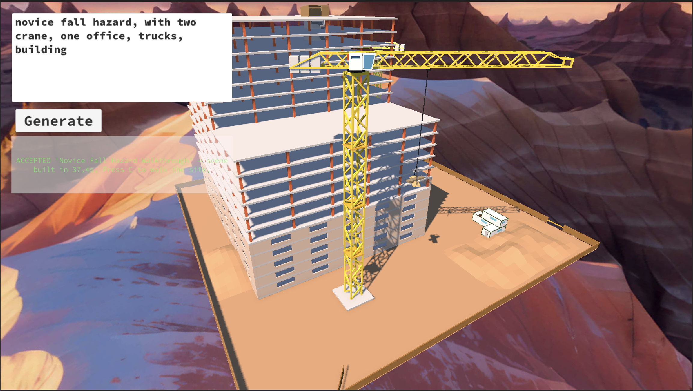
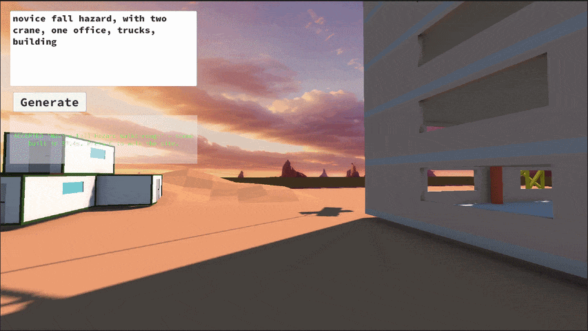

# CS-ISR

Construction-safety scenario generator for Unity. You type a natural-language command (e.g. *"Create a novice material-transport task with one subtle fall hazard and one blocked pedestrian route"*), and it uses an LLM to plan a construction site, validates and repairs the plan, then builds it as a playable Unity scene — your command in, a walkable scenario out.

## Setup

- Requires a **DeepSeek API key**. Set it in the scene's `AppManager`, in the editor window's Settings tab (EditorPrefs), or in `~/deepseek_config.json` for builds.
- Open the project in Unity, press Play, type a prompt, hit **Generate**.

## Controls

- **Fly camera:** WASD + mouse (hold RMB to look).
- **C** — switch to walking the site as the worker (WASD / Shift to run, mouse to look).

Full details in [documentation.md](documentation.md).
